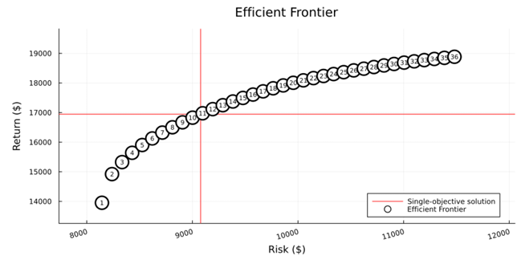
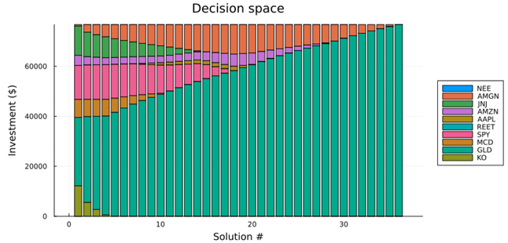

# Multi-Objective Investment Portfolio Optimization

Optimizing the allocation of ~$76.7K free cash flow of an IT company across 10 assets using Modern Portfolio Theory, with Julia/JuMP for optimization and Python for data collection.

## Overview

**Business problem.** An IT company wants to turn idle cash into working assets: build a financial safety buffer and fund long-term growth without touching operating capital. Since the company's core business is already tied to the tech sector, the portfolio should be diversified *away* from it.

**Solution.** A Markowitz mean-variance model that:
1. finds the portfolio with the maximum Sharpe ratio (single-objective), and
2. builds the full efficient frontier by minimizing risk and maximizing return simultaneously (multi-objective), so management can pick a point matching its risk tolerance.

## Key Results

| Portfolio | Expected return | Volatility | Sharpe ratio |
|---|---|---|---|
| **Max Sharpe** | 22.10% ($16,947) | 11.84% ($9,078) | **1.53** |
| Min-risk end of frontier (#1) | 18.20% ($13,953) | 10.62% ($8,144) | 1.34 |

**Max-Sharpe allocation**

| Asset | Weight | Amount |
|---|---|---|
| GLD (gold ETF) | 64.93% | $49,788 |
| SPY (S&P 500 ETF) | 13.88% | $10,643 |
| AMGN | 11.61% | $8,899 |
| JNJ | 4.56% | $3,499 |
| AMZN | 3.54% | $2,714 |
| AAPL | 1.48% | $1,137 |
| NEE, REET, MCD, KO | ~0% | – |

**Efficient frontier.** 36 Pareto-optimal portfolios. The red lines mark the max-Sharpe solution.

**How allocation changes with risk.** Conservative portfolios spread capital across many stable assets (JNJ, KO, MCD, SPY); moving toward higher return concentrates capital in fewer, more volatile assets, mainly GLD.

## Methodology

**Data.** Monthly prices and dividends for 10 tickers over 48 months (Feb 2022 – Feb 2026), downloaded with `yfinance`. Assets were chosen from sectors with low correlation to IT: healthcare, utilities, REITs, commodities, consumer staples, plus broad-market and tech references.

Tickers: `NEE, AMGN, JNJ, AMZN, AAPL, REET, SPY, MCD, GLD, KO`

**Total return** (dividends included, otherwise returns are understated):

$$r_i(t) = \frac{p_i(t+1) - p_i(t) + d_i(t)}{p_i(t)}$$

Mean returns and the covariance matrix Σ are estimated from monthly returns and annualized (×12).

**Model 1: maximize the Sharpe ratio**

$$\max_w \; \frac{w^\top \mu - r_f}{\sqrt{w^\top \Sigma w}} \quad \text{s.t.} \quad \sum_i w_i = 1,\; w_i \ge 0$$

**Model 2: efficient frontier** (ε-constraint method, 36 solutions)

$$\min_x \; \left[\sigma_p,\; -r_p\right] \quad \text{s.t.} \quad \sum_i x_i = C,\; x_i \ge 0$$

## Tech Stack

- **Julia:** JuMP, Ipopt, MultiObjectiveAlgorithms, DataFrames, Plots, StatsPlots
- **Python:** yfinance, pandas
